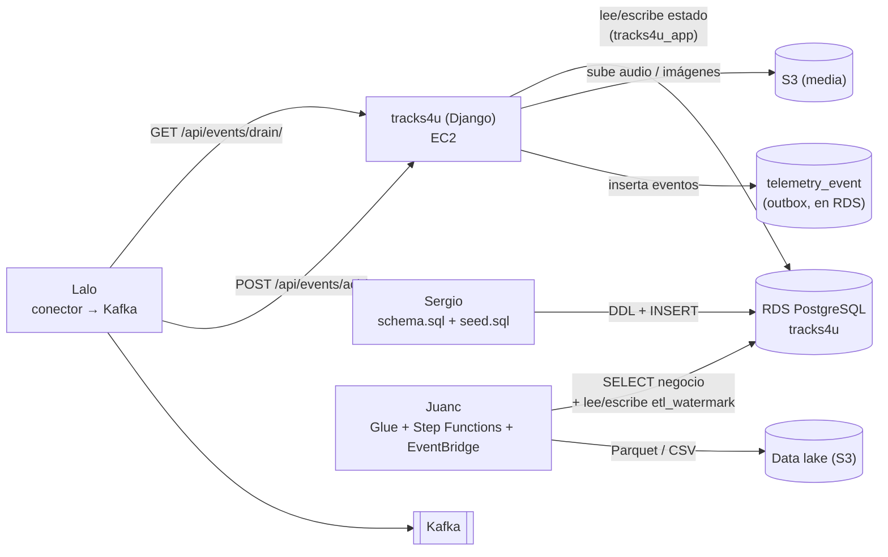
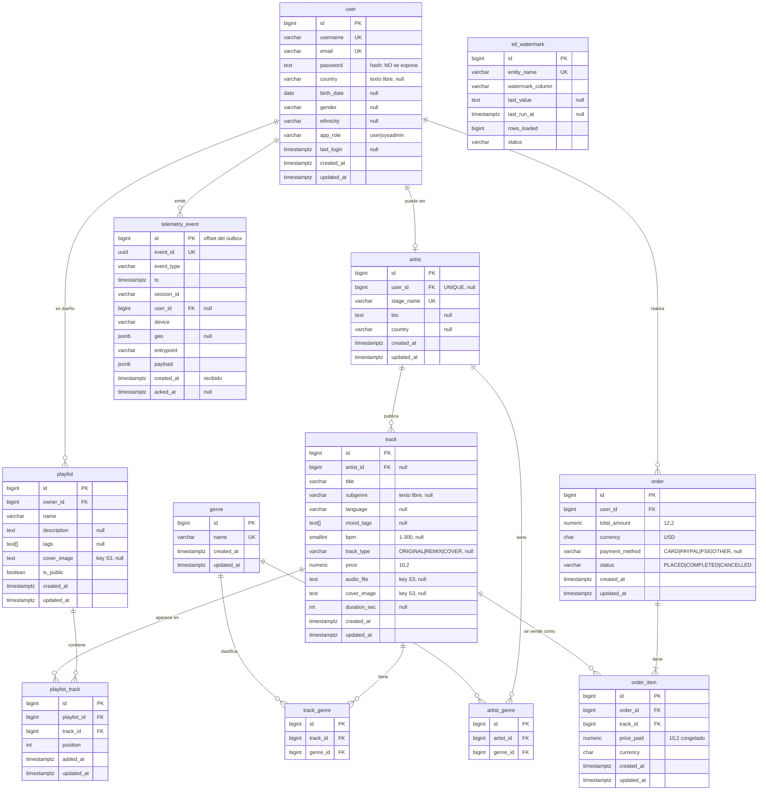

# contrato.md — Contrato de datos de tracks4u

**Para:** Sergio (SQL → RDS), Juanc (ingesta batch/CDC), Lalo (streaming → Kafka).
**De:** Miguel (app tracks4u).
**Estado de verificación (T8):** Verificado contra la implementación el `2026-11-18` (commit base `0ca5936`, `database/check_contract_er.py` → `OK`).
**Fuente de verdad del esquema:** `database/schema.sql`. Este documento lo resume; si difieren, manda `schema.sql`.
**Datos iniciales:** `database/seed.sql` (requiere `schema.sql` aplicado antes) + `database/seed_media_updates.sql` / `python manage.py sync_seed_media` (sincronización de las 36 canciones `.opus` y 33 portadas hacia S3 y RDS).
**Referencia de infraestructura:** repo de la materia `https://github.com/SI3008/2026-2.git` (RDS PostgreSQL, rol de ingesta, `database/rds/`).

Cualquier cambio de tabla, columna, evento o endpoint se avisa a los tres **antes** de aplicarlo.

---

## 1. Cómo se conecta cada uno con tracks4u



| Quién | Qué toca de tracks4u | Por dónde |
|---|---|---|
| Sergio | Esquema y datos iniciales | `database/schema.sql`, `database/seed.sql` contra RDS |
| Juanc | Tablas de negocio (lectura) y `etl_watermark` (lectura/escritura) | JDBC a RDS |
| Lalo | Eventos de comportamiento | HTTP al endpoint de drenaje de la app |

**Regla de oro:** Juanc **no** lee `telemetry_event`; Lalo **no** lee tablas de negocio. Cada flujo tiene un solo camino.

## 2. Datos de conexión (sin secretos)

| Dato | Valor |
|---|---|
| Motor | PostgreSQL 14+ (Amazon RDS), región `us-east-1` |
| Host | `tracks4u-postgres-dev.c4qkjciamuny.us-east-1.rds.amazonaws.com` |
| Puerto | `5432` |
| Base de datos | `tracks4u` |
| Usuario de la aplicación | `tracks4u_app` |
| SSL | obligatorio (`sslmode=require`) |
| Red | **subred privada**: solo accesible desde la VPC (EC2 del proyecto, conexión de Glue dentro de la VPC) |
| Contraseñas | **nunca en el repo**; se entregan por el canal privado del equipo |
| Bucket S3 (media + RAW streaming) | `s3://tracks4u-datalake-463790652932-us-east-1/` (región `us-east-1`, acceso vía IAM Role desde la EC2 `tracks4u-app`) |
| Endpoint de la app (Lalo, en `tracks4u-app`) | `http://127.0.0.1:8000/api/events/drain/` y `http://127.0.0.1:8000/api/events/ack/` |
| Broker Kafka (en `tracks4u-app`, `~/tracks4u-streaming`) | `127.0.0.1:9092`, topic `tracks4u.events`, destino S3 `s3://tracks4u-datalake-463790652932-us-east-1/raw/entity=play_events/` |
| Token de drenaje (Lalo) | `TELEMETRY_DRAIN_TOKEN`, por canal privado |

## 3. Diagrama entidad-relación (esquema definitivo)



Notas de lectura:
- `etl_watermark` no tiene relaciones: es una tabla de control del pipeline (§7).
- `"user"` y `"order"` son palabras reservadas de SQL: **siempre entre comillas dobles** en las consultas.
- `UNIQUE`: `(track_id, genre_id)` en `track_genre`, `(artist_id, genre_id)` en `artist_genre`, `(playlist_id, track_id)` y `(playlist_id, position)` (esta última diferida) en `playlist_track`, `(order_id, track_id)` en `order_item`.
- `CHECK`: `price >= 0`, `bpm` entre 1 y 300, `position > 0`, `gender`, `track_type`, `payment_method`, `status`, `device` y `entrypoint` con valores cerrados.
- `like`, `follow` y `share` **no tienen tabla**: solo existen como eventos (§8).

### Diferencias respecto al diagrama del pitch

| Tema | Pitch | Esquema vigente |
|---|---|---|
| `ingested_at` | En cada tabla | **Eliminado de RDS.** Lo agrega el pipeline en el lake. |
| `etl_watermark` | Sí | **Se mantiene**, en RDS (§7). |
| `mood_tags` (`track`), `tags` (`playlist`) | Arreglos de texto | **Se mantienen** como `TEXT[]`. |
| Géneros | `track.genre`, `artist.genres TEXT[]` | **Reemplazados** por la tabla `genre` + puentes `track_genre` y `artist_genre`. `track.subgenre` se mantiene como texto libre. |
| `"user".app_role` | No existe | Presente en tu esquema: identifica al `sysadmin`. |
| `"user".last_login` | No existe | Añadido: lo usa el login de Django. |
| `order_item.created_at` | No existe | Añadido (`created_at` + `updated_at`). |
| `telemetry_event` | No existe | Añadida (outbox de eventos). |

## 4. Reglas comunes

| Regla | Detalle |
|---|---|
| Claves | `BIGINT GENERATED BY DEFAULT AS IDENTITY`. Todas las tablas tienen `id`. |
| Tiempos | `TIMESTAMPTZ`, en UTC. |
| `created_at` / `updated_at` | `NOT NULL DEFAULT CURRENT_TIMESTAMP`. `updated_at` se actualiza **en cada `UPDATE`** con un trigger de BD (`trg_<tabla>_set_updated_at`), venga el cambio de la app, de SQL directo o de una carga masiva. |
| Excepciones de tiempos | `playlist_track` usa `added_at` como "creado". `track_genre`, `artist_genre`, `telemetry_event` y `etl_watermark` no tienen `updated_at`. |
| Borrados | No hay borrado lógico. `"order"` y `order_item` no se borran desde la app. `playlist`, `playlist_track` y las tablas puente **sí pueden borrarse físicamente**. |
| Países | `country` es **texto libre con el nombre del país** (p. ej. `Colombia`, `United States`), no código ISO. |
| Archivos | `audio_file` y `cover_image` guardan la **key relativa** en S3 (no la URL). El bucket es privado. |
| Moneda | Una sola (`USD`); el campo `currency` se conserva por si crece. |

## 5. Resumen por tabla

| Tabla | Estrategia de extracción (Juanc) | Columnas legibles / notas |
|---|---|---|
| `"user"` | Snapshot completo diario | **Solo** `id, username, country, birth_date, gender, ethnicity, created_at, updated_at`. Sin `email`, `password`, `app_role`, `last_login`. |
| `artist` | Snapshot completo diario | todas |
| `genre` | Snapshot completo diario | Catálogo pequeño (20 filas iniciales). |
| `artist_genre` | Snapshot completo diario | Sin timestamps. |
| `track_genre` | Snapshot completo diario | Sin timestamps. |
| `track` | Snapshot completo diario | todas |
| `playlist` | Snapshot completo diario | Puede borrarse. |
| `playlist_track` | Snapshot completo diario | Los borrados solo se ven comparando snapshots. |
| `"order"` | **Incremental por `updated_at`** | No se borra desde la app. |
| `order_item` | **Incremental por `updated_at`** | No se borra desde la app. |
| `telemetry_event` | **No se extrae por batch** | Va por el endpoint de Lalo (§8). |
| `etl_watermark` | Control del pipeline | Ver §7. |

Por qué snapshot en las tablas que pueden perder filas: un filtro por `updated_at` no ve filas eliminadas. La estrategia es una recomendación; Juanc puede pedir incremental también en otras tablas, y funciona porque todas tienen `updated_at` con trigger.

---

## 6. Sergio — Esquema y carga de datos en RDS

**Entregables que ya existen:**
- `database/schema.sql`: DDL completo, con triggers, índices y el catálogo de 20 géneros. Es **re-ejecutable** (`IF NOT EXISTS`, `DROP TRIGGER IF EXISTS`, `ON CONFLICT DO NOTHING`).
- `database/seed.sql`: 6 usuarios, 14 artistas con sus géneros, 36 canciones, 3 playlists, y una fila por entidad en `etl_watermark`. También re-ejecutable.

**Orden de ejecución** (siguiendo el patrón del repo del profe): roles → `schema.sql` → permisos → `seed.sql` → verificación.

**Tablas de Django.** La app crea además sus tablas internas (`django_migrations`, `auth_*`, `django_session`, etc.) con `manage.py migrate` en la misma base. Quedan fuera de este contrato y **no** deben exponerse al pipeline. Ejecuta `schema.sql` **antes** de `migrate`.

**Reglas para cualquier SQL de carga que escribas**
- Orden por claves foráneas: `genre` → `"user"` → `artist` → `artist_genre` → `track` → `track_genre` → `playlist` → `playlist_track` → `"order"` → `order_item`.
- Idempotente: `ON CONFLICT … DO NOTHING` (o `DO UPDATE` si procede). Para `playlist_track` usa el objetivo explícito `ON CONFLICT (playlist_id, track_id)`: PostgreSQL no admite como árbitro una restricción diferida (`playlist_id, position`).
- Si insertas con `id` explícito, ajusta la secuencia después: `SELECT setval(pg_get_serial_sequence('"user"','id'), (SELECT MAX(id) FROM "user"))`, y lo mismo para cada tabla.
- No escribas en `telemetry_event` ni en tablas de Django.
- `password`: `'!RESET_REQUIRED!'` o cualquier valor que empiece por `!` marca una contraseña inutilizable en Django; esos usuarios no pueden iniciar sesión hasta tener un hash generado por la app.
- Valores cerrados: `gender` ∈ `FEMALE, MALE, NON_BINARY, PREFER_NOT_TO_SAY`; `track_type` ∈ `ORIGINAL, REMIX, COVER`; `payment_method` ∈ `CARD, PAYPAL, PSE, OTHER`; `status` ∈ `PLACED, COMPLETED, CANCELLED`. `"order".total_amount` debe igualar la suma de `price_paid` de sus items.
- `audio_file`: una key coherente (`audio/<artist_id>/<nombre>.mp3`) aunque el objeto aún no exista en S3; esas canciones no se podrán reproducir hasta que lo suba alguien.
- Los nombres `"user"` y `"order"` van siempre entre comillas dobles.

## 7. Juanc — Ingesta batch/CDC (Glue + Step Functions + EventBridge)

**Acceso:** JDBC a RDS (§2), con SSL, desde la VPC.

**Permisos del rol de Glue** (el nombre del rol está pendiente, §9):

| Objeto | Permiso |
|---|---|
| Tablas de negocio (§5) | `SELECT` solamente. En `"user"`, solo las columnas listadas en §5. |
| `etl_watermark` | `SELECT`, `INSERT`, `UPDATE` |
| `telemetry_event`, `django_*`, `auth_*` | **ninguno** |

Ese rol **no** es de solo lectura puro: necesita escribir en `etl_watermark`. No usa `DELETE` ni DDL.

### 7.1 `etl_watermark`

| Columna | Uso |
|---|---|
| `entity_name` | Nombre de la tabla extraída (`user`, `artist`, `genre`, `track`, `playlist`, `playlist_track`, `order`, `order_item`). Es único. |
| `watermark_column` | Columna de control. Hoy `updated_at` para todas. |
| `last_value` | Último watermark procesado, como texto (timestamp ISO 8601 en UTC). `NULL` = primera carga completa. |
| `last_run_at` | Fin de la última corrida. |
| `rows_loaded` | Filas cargadas en la última corrida. |
| `status` | Estado de la corrida (`pending` inicial; el resto de valores los define el pipeline). |

`seed.sql` inserta una fila por entidad con `last_value = NULL` y `status = 'pending'`. Si prefieres que el pipeline las cree, usa `INSERT … ON CONFLICT (entity_name) DO NOTHING`. La app **no** lee ni escribe esta tabla.

### 7.2 Cómo detectar cambios

- Columna de control: `updated_at` (`TIMESTAMPTZ NOT NULL`, mantenida por trigger). Cada `UPDATE` la avanza.
- Incremental: `WHERE updated_at > <last_value>`. Recomendado restar una ventana de solapamiento (p. ej. 5 minutos) y deduplicar por `id` al escribir: dos transacciones pueden confirmarse en distinto orden que sus `updated_at`.
- Snapshot: lectura completa; los borrados se infieren comparando contra la corrida anterior.
- `ingested_at` lo añade tu pipeline en el lake; no existe en RDS.

**Particionado sugerido (guía de la materia):** `entity=<tabla>/ingest_date=YYYY-MM-DD/`.

**Tipos:** `bigint` → long; `numeric(p,s)` → decimal(p,s), no float; `timestamptz` → timestamp UTC; `boolean`, `date`, `text` directos; `text[]` (`mood_tags`, `tags`) → array de strings (nulo si no hay valores).

### 7.3 Primera prueba de integración (carga incremental)

| Dato | Valor |
|---|---|
| Tabla | `genre` |
| Clave primaria | `id` (`BIGINT`) |
| Columnas para analítica | `id, name, created_at, updated_at` |
| Columna incremental | `updated_at` (`TIMESTAMPTZ NOT NULL`, trigger `trg_genre_set_updated_at`) |
| Fila de watermark | `entity_name = 'genre'` en `etl_watermark` |
| Registro de prueba | `name = 'zz_incremental_test'` — **ID: se informa al crearlo** |

Por qué `genre`: no tiene claves foráneas ni archivos ni datos personales, así que el registro se crea y se modifica sin efectos laterales. Tras `schema.sql` contiene 20 géneros; la primera extracción los traerá todos.

**Secuencia acordada**
1. Miguel aplica `schema.sql` (y `seed.sql`), crea el registro (`INSERT INTO genre (name) VALUES ('zz_incremental_test')`) y pasa a Juanc **tabla + `id` + `updated_at`**.
2. Juanc hace la primera extracción y avisa. Su `last_value` en `etl_watermark` queda en el `updated_at` máximo.
3. Miguel modifica **ese mismo** registro (`UPDATE genre SET name = 'zz_incremental_test_v2' WHERE id = <id>`) y confirma el nuevo `updated_at`, que debe ser mayor.
4. Juanc hace la segunda extracción: debe traer solo esa fila (más cualquier otra modificada después del watermark).

Después de esta prueba, las tablas de interés real son `"order"` / `order_item` (incrementales) y `track` / `"user"` (snapshot).

## 8. Lalo — Streaming: endpoint de drenaje → Kafka

**Patrón:** *outbox* + *pull*. La app guarda cada evento en `telemetry_event`; tu conector lo lee por HTTP, lo produce a Kafka y lo confirma. La app **no conoce Kafka**. Entrega *at-least-once*: pueden llegar duplicados; deduplica por `event_id`.

### 8.1 Endpoints

| Método y ruta | Quién | Auth | Función |
|---|---|---|---|
| `POST /api/events/` | Front de tracks4u | JWT opcional | Ingesta de eventos del navegador (**no lo usas tú**). |
| `GET /api/events/drain/?since=<id>&limit=<n>` | **Lalo** | `Authorization: Bearer <TELEMETRY_DRAIN_TOKEN>` | Lote de eventos pendientes. `since` default `0`; `limit` default `500`, máx. `1000`. |
| `POST /api/events/ack/` | **Lalo** | mismo token | Confirma hasta `last_id`. |

Sin token o con token inválido: `401`.

### 8.2 Respuesta del drenaje (ejemplos verificados por familia de eventos)

```json
{
  "events": [
    {
      "id": 1042,
      "event_id": "7b0c4c2e-5a4e-4c5e-9c77-0b6a2a7a3f10",
      "schema_version": 1,
      "event_type": "play_start",
      "ts": "2026-11-18T15:04:05.123Z",
      "received_at": "2026-11-18T15:04:05.801Z",
      "session_id": "s_3f9a1c7e2b",
      "user_id": 2,
      "device": "web_desktop",
      "geo": {"country": "Colombia"},
      "entrypoint": "playlist",
      "payload": {"track_id": 6, "playlist_id": 1}
    },
    {
      "id": 1044,
      "event_id": "9d2e6e4a-7c6a-4e7a-9e99-2d8c4c9c5b32",
      "schema_version": 1,
      "event_type": "skip",
      "ts": "2026-11-18T15:04:05.123Z",
      "received_at": "2026-11-18T15:04:05.801Z",
      "session_id": "s_3f9a1c7e2b",
      "user_id": 2,
      "device": "web_desktop",
      "geo": {"country": "Colombia"},
      "entrypoint": "playlist",
      "payload": {"track_id": 6, "position_sec": 42, "percent_listened": 35}
    },
    {
      "id": 1045,
      "event_id": "ae3f7f5b-8d7b-4f8b-8faa-3e9d5dad6c43",
      "schema_version": 1,
      "event_type": "search",
      "ts": "2026-11-18T15:04:05.123Z",
      "received_at": "2026-11-18T15:04:05.801Z",
      "session_id": "s_3f9a1c7e2b",
      "user_id": 2,
      "device": "web_desktop",
      "geo": {"country": "Colombia"},
      "entrypoint": "search",
      "payload": {
        "search_id": "11111111-2222-4333-8444-555555555555",
        "query": "reggaeton",
        "results_count": 12,
        "clicked_track_id": 14
      }
    },
    {
      "id": 1046,
      "event_id": "bf4a8a6c-9e8c-4a9c-9abb-4fae6ebe7d54",
      "schema_version": 1,
      "event_type": "playlist_add",
      "ts": "2026-11-18T15:04:05.123Z",
      "received_at": "2026-11-18T15:04:05.801Z",
      "session_id": "s_3f9a1c7e2b",
      "user_id": 2,
      "device": "web_desktop",
      "geo": {"country": "Colombia"},
      "entrypoint": "playlist",
      "payload": {"playlist_id": 1, "track_id": 14, "position": 5}
    },
    {
      "id": 1047,
      "event_id": "c05b9b7d-af9d-4bad-8bcc-50bf7fcf8e65",
      "schema_version": 1,
      "event_type": "purchase_intent",
      "ts": "2026-11-18T15:04:05.123Z",
      "received_at": "2026-11-18T15:04:05.801Z",
      "session_id": "s_3f9a1c7e2b",
      "user_id": 2,
      "device": "web_desktop",
      "geo": {"country": "Colombia"},
      "entrypoint": "track_page",
      "payload": {"track_id": 14, "stage": "completed", "order_id": 1, "price": 4.99}
    }
  ],
  "next_cursor": 1047,
  "has_more": false
}
```

- `id` y `user_id` son enteros; `event_id` es un UUID. `user_id` es `null` en visitantes anónimos.
- `id` es solo el offset del outbox; los consumidores deduplican por `event_id`.
- `geo.country` usa el mismo formato que `"user".country` (nombre del país, texto libre) y es `null` si no se conoce.
- Los eventos tardan unos 5 segundos en estar disponibles (ventana de asentamiento que evita perder eventos confirmados fuera de orden).

### 8.3 Confirmación

```
POST /api/events/ack/
{"last_id": 1042}
→ 200 {"acked": 37}
```

Marca como entregados todos los eventos con `id <= last_id`. Es idempotente.

### 8.4 Algoritmo recomendado del conector

```text
cursor = 0
loop:
    r = GET /api/events/drain/?since=cursor&limit=500
    si r.events está vacío: dormir 2–5 s; continuar
    producir r.events a Kafka (valor = JSON del evento tal cual)
    esperar flush / acks del broker
    POST /api/events/ack/ {"last_id": r.next_cursor}   # solo después del flush
    cursor = r.next_cursor
    si r.has_more: seguir sin dormir
```

Si el conector falla antes del `ack`, el lote reaparece en el siguiente `GET`. Si pierdes el cursor, reinicia con `since=0`: solo verás lo no confirmado.

**Sugerencias para Kafka (decides tú):** topic `tracks4u.events.v1`; clave del mensaje = `session_id` (conserva el orden dentro de una sesión); valor = el JSON del evento.

### 8.5 Catálogo de eventos

Todos los IDs (`track_id`, `playlist_id`, `artist_id`, `order_id`) son **enteros**, salvo `search_id`, que es un UUID. Campos con `?` son opcionales.

| `event_type` | Origen | Payload |
|---|---|---|
| `play_start` | front | `track_id`, `playlist_id?` |
| `play_progress` | front | `track_id`, `position_sec`, `percent_listened` (0–100) |
| `play_complete` | front | `track_id`, `seconds_listened` |
| `skip` | front | `track_id`, `position_sec`, `percent_listened` |
| `pause`, `resume` | front | `track_id`, `position_sec` |
| `seek` | front | `track_id`, `from_sec`, `to_sec` |
| `like`, `unlike` | front | `track_id` |
| `follow`, `unfollow` | front | `artist_id` |
| `share` | front | `track_id`, `channel?` |
| `playlist_add` | servidor | `playlist_id`, `track_id`, `position` |
| `page_view` | front | `view`, `referrer?` |
| `dwell_time` | front | `view`, `seconds`, `max_scroll_pct?` |
| `search` | front | `search_id`, `query`, `results_count`, `clicked_track_id?` (segundo evento con el mismo `search_id` al hacer clic) |
| `purchase_intent` | front + servidor | `track_id`, `stage` (`checkout_start`, `completed`, `failed`), `order_id?`, `price?` |

Valores de contexto: `device` ∈ `web_desktop, web_mobile, web_tablet, unknown`; `entrypoint` ∈ `home, search, artist_profile, playlist, track_page, library, external_link, unknown`.

`like`/`follow`/`share` no tienen tabla en RDS: **solo existen en este flujo**.

**Retención:** la app borra los eventos confirmados con más de 7 días. Los no confirmados se conservan.

## 9. Pendientes abiertos

| # | Pendiente | Responsable |
|---|---|---|
| 1 | Dónde corre Django (EC2 del proyecto o cuenta propia de AWS Academy) y qué IP/DNS usa Lalo para el endpoint | Miguel → Juanc y Lalo |
| 2 | Nombre del usuario de Glue y quién le otorga los permisos de §7 | Miguel y Juanc |
| 3 | Nombre del bucket S3 de media | Miguel |
| 4 | Entrega del `TELEMETRY_DRAIN_TOKEN` a Lalo | Miguel |
| 5 | `id` del registro de prueba de `genre` (§7.3) | Miguel, tras aplicar `schema.sql` |
| 6 | Valores de `etl_watermark.status` que usará el pipeline | Juanc |

## 10. Qué NO hace la app

- No publica a Kafka, no escribe en el data lake, no calcula perfiles derivados ni features de ML.
- No lee ni escribe `etl_watermark`.
- No expone `email` ni `password` al pipeline.
