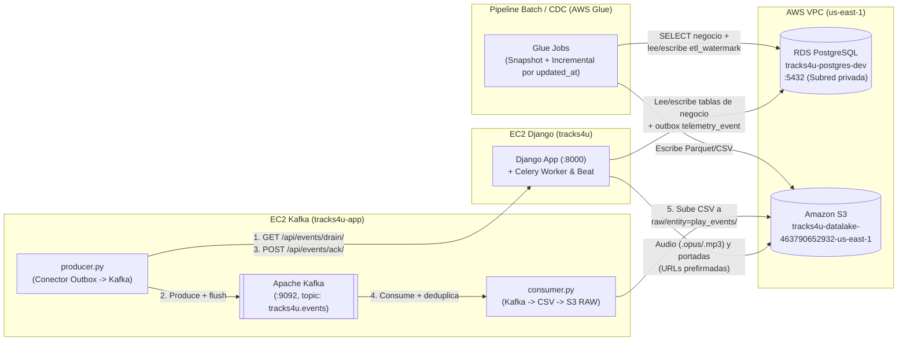

# Tracks4U — Plataforma de Música y Fuente de Datos (RDS PostgreSQL + S3 + Kafka Streaming)

Repositorio oficial de **Tracks4U**: aplicación web transaccional en Django conectada a **Amazon RDS PostgreSQL** y **Amazon S3**, diseñada como fuente de datos para los pipelines de ingesta **Batch/CDC (AWS Glue)** y **Streaming (Apache Kafka → S3 RAW)**.

---

## 1. Arquitectura General



### Estructura del Repositorio
| Carpeta / Archivo | Descripción |
|---|---|
| `tracks4u/` | Aplicación Django (modelos mapeados al esquema SQL, órdenes de compra, playlists, outbox de telemetría `/api/events/`, almacenamiento en S3 y comando `sync_seed_media`). |
| `database/schema.sql` | **Fuente de verdad del esquema en PostgreSQL.** Define las 12 tablas (`"user"`, `artist`, `genre`, `artist_genre`, `track`, `track_genre`, `playlist`, `playlist_track`, `"order"`, `order_item`, `telemetry_event`, `etl_watermark`), `CHECK` constraints, índices, los 8 triggers `trg_<tabla>_set_updated_at` y el catálogo inicial de 20 géneros. |
| `database/seed.sql` | Datos iniciales idempotentes: 6 usuarios, 14 artistas con sus géneros, 36 canciones, 3 playlists y las filas iniciales de `etl_watermark`. |
| `database/seed_media_updates.sql` | Script SQL idempotente que actualiza las 36 canciones del seed con títulos corregidos, duración real en segundos (`duration_sec`), precios, BPM, idioma, keys relativas en S3 (`audio/...` y `covers/tracks/...`) y sus relaciones en `track_genre`. |
| `database/rds/` | Scripts `grants.sql` (permisos de aplicación e ingesta) y `verify.sql` (validación del despliegue en RDS). |
| `cancionesCovers/tracks4u/` | Archivos multimedia locales de las 36 canciones (`.opus`) y 33 portadas (`.webp`, `.jpg`, `.jpeg`, `.png`) listos para subirse a S3 con `python manage.py sync_seed_media`. |
| `tracks4u-streaming/tracks4u-streaming/` | Pipeline de streaming con Kafka (`docker-compose.yml`, `producer.py` conectado al outbox de Django y `consumer.py` que escribe lotes CSV en S3 zona RAW). |
| `tracks4u-recommender/` | Módulo ML de recomendación musical Item-Item (`recommend.py`, `gen_synthetic.py`, `check_output.py`, `Dockerfile` y `docker-compose.yml` aislado que lee de RAW y escribe Parquet en S3 zona ANALYTICS sin afectar Django ni Kafka). |

---

## 2. Despliegue Paso a Paso en la EC2 de Tracks4U (`i-09a7a5a131a32bd0e`)

> **Datos de la instancia EC2 en `us-east-1`:**
> - **Instance ID:** `i-09a7a5a131a32bd0e` (`ubuntu@ip-10-0-21-126`, IP privada `10.0.21.126`, IP pública `54.92.130.85`)
> - **Security Group:** `sg-003aae4d93d98bfc0` (`tracks4u-app-sg`)
> - **IAM Profile asociado:** `LabInstanceProfile` (`LabRole`, con permisos `s3:ListBucket` y `s3:PutObject` verificados sobre `s3://tracks4u-datalake-463790652932-us-east-1/`)
> - **Requisito de red:** El RDS (`tracks4u-postgres-dev.c4qkjciamuny.us-east-1.rds.amazonaws.com:5432`) está en una subred privada, por lo que todos los comandos de base de datos y de Django deben ejecutarse **desde la instancia EC2 dentro de la VPC**.

### 2.0 Recuperar acceso SSH desde AWS CloudShell (si cambió la IP de CloudShell)
Cuando AWS CloudShell se reinicia, su IP pública saliente cambia y el Security Group `sg-003aae4d93d98bfc0` bloquea el puerto 22. Para autorizar automáticamente la IP actual de CloudShell y entrar por SSH a la EC2, ejecuta en **AWS CloudShell**:

```bash
# 1. Autorizar la IP pública actual de CloudShell en el puerto 22 del Security Group
MY_IP=$(curl -s https://checkip.amazonaws.com | tr -d '\n')
aws ec2 authorize-security-group-ingress \
  --region us-east-1 \
  --group-id sg-003aae4d93d98bfc0 \
  --protocol tcp \
  --port 22 \
  --cidr "${MY_IP}/32" 2>/dev/null || true

# 2. Entrar a la EC2
aws ec2-instance-connect ssh --region us-east-1 \
  --instance-id i-09a7a5a131a32bd0e --os-user ubuntu --connection-type direct
```

### 2.1 Clonar el repositorio e instalar dependencias
En la instancia EC2 donde correrá Django:

```bash
sudo apt update && sudo apt install -y python3-venv python3-pip postgresql-client git

git clone https://github.com/miguelangel17z/tracks4u.git ~/tracks4uProject
cd ~/tracks4uProject

python3 -m venv .venv
source .venv/bin/activate
pip install --upgrade pip
pip install -r tracks4u/requirements.txt
```

### 2.2 Configurar las variables de entorno (`tracks4u/.env`)
Crea el archivo `tracks4u/.env` a partir de la plantilla `tracks4u/.env.example`:

```bash
cp tracks4u/.env.example tracks4u/.env
nano tracks4u/.env
```

Completa `tracks4u/.env` con los siguientes valores (sustituyendo `<DB_PASSWORD>` por la contraseña de `tracks4u_app` y definiendo un `<TELEMETRY_DRAIN_TOKEN>` aleatorio de al menos 32 caracteres que compartirás con `producer.py`):

```env
# Django
SECRET_KEY=t4u-prod-secret-key-9f8e7d6c5b4a3f2e1d0c9b8a7f6e5d4c3b2a
DEBUG=true
ALLOWED_HOSTS=localhost,127.0.0.1,0.0.0.0,*
CSRF_TRUSTED_ORIGINS=http://localhost,http://127.0.0.1

# RDS PostgreSQL
DB_HOST=tracks4u-postgres-dev.c4qkjciamuny.us-east-1.rds.amazonaws.com
DB_PORT=5432
DB_NAME=tracks4u
DB_USER=tracks4u_app
DB_PASSWORD=<DB_PASSWORD>
DB_SSLMODE=require

# Amazon S3 (en la EC2 usa automáticamente el IAM Role si las keys se dejan vacías)
AWS_STORAGE_BUCKET_NAME=tracks4u-datalake-463790652932-us-east-1
AWS_S3_REGION_NAME=us-east-1
AWS_ACCESS_KEY_ID=
AWS_SECRET_ACCESS_KEY=

# Celery (opcional si no se levanta Redis)
CELERY_BROKER_URL=redis://localhost:6379/0
CELERY_RESULT_BACKEND=redis://localhost:6379/0

# Telemetría (Outbox -> Kafka)
TELEMETRY_DRAIN_TOKEN=<TELEMETRY_DRAIN_TOKEN>
TELEMETRY_SETTLE_SECONDS=5
TELEMETRY_RETENTION_DAYS=7
TELEMETRY_DRAIN_MAX_LIMIT=1000

# Notificaciones
NOTIFICATION_MODE=MOCK
```

### 2.3 Aplicar migraciones en RDS y cargar datos semilla (`schema.sql` + `seed.sql`)
La migración inicial de Django (`core.0001_schema`) ejecuta automáticamente `database/schema.sql` de forma idempotente (creando las 12 tablas de negocio, los 8 triggers `trg_<tabla>_set_updated_at` y los 20 géneros base) además de las tablas internas de Django:

```bash
cd ~/tracks4uProject/tracks4u
source ../.venv/bin/activate

# 1. Comprobar conectividad con RDS
python manage.py check --database default

# 2. Aplicar esquema SQL y migraciones de Django
python manage.py migrate

# 3. Cargar los datos iniciales y la tabla etl_watermark (idempotente)
PGSSLMODE=require psql \
  -h tracks4u-postgres-dev.c4qkjciamuny.us-east-1.rds.amazonaws.com \
  -p 5432 -U tracks4u_app -d tracks4u \
  -f ../database/seed.sql
```

### 2.4 Subir las 36 canciones (`.opus`) y 33 portadas a S3 y actualizar metadatos en RDS
El repositorio incluye en `cancionesCovers/tracks4u/` los 36 archivos de audio y las 33 portadas correspondientes al seed, junto con el comando `sync_seed_media` que:
1. Sube cada archivo de audio a `s3://tracks4u-datalake-463790652932-us-east-1/audio/<artist_id>/<uuid>.opus` y cada portada a `s3://tracks4u-datalake-463790652932-us-east-1/covers/tracks/<uuid>.<ext>`.
2. Actualiza en la tabla `track` de RDS los títulos completos (corrigiendo los títulos truncados del seed original), la duración real en segundos (`duration_sec`), el precio, BPM, idioma, tipo de track, las keys de S3 (`audio_file` y `cover_image`) y las relaciones en `track_genre`.

Ejecuta desde `~/tracks4uProject/tracks4u`:

```bash
# Vista previa sin modificar S3 ni RDS (opcional)
python manage.py sync_seed_media --dry-run

# Subida real a S3 y actualización de metadatos en RDS
python manage.py sync_seed_media
```

*(Nota: Si en algún momento solo deseas actualizar los metadatos en RDS por SQL sin re-subir los archivos a S3, puedes usar `python manage.py sync_seed_media --skip-s3` o ejecutar `psql ... -f ../database/seed_media_updates.sql`).*

### 2.5 Arrancar el servidor Django
Para que el portal web y los endpoints de telemetría (`/api/events/`, `/api/events/drain/`, `/api/events/ack/`) sean accesibles dentro de la VPC:

```bash
cd ~/tracks4uProject/tracks4u
source ../.venv/bin/activate
python manage.py runserver 0.0.0.0:8000
```

---

## 3. Prueba de Carga Incremental (CDC con AWS Glue)

Todas las tablas con `updated_at` (`"user"`, `artist`, `genre`, `track`, `playlist`, `playlist_track`, `"order"`, `order_item`) tienen un trigger en PostgreSQL (`trg_<tabla>_set_updated_at`) que actualiza automáticamente `updated_at = CURRENT_TIMESTAMP` en cada `UPDATE`.

Para validar la extracción incremental del pipeline de Glue usando la tabla `genre`:

1. **Crear el registro de prueba antes de la primera corrida de Glue:**
   ```bash
   cd ~/tracks4uProject/tracks4u
   source ../.venv/bin/activate
   python manage.py shell -c "
   from tracks.models import Genre
   g, _ = Genre.objects.get_or_create(name='zz_incremental_test')
   print('TABLA: genre')
   print('ID:', g.id)
   print('updated_at (antes):', g.updated_at.isoformat())
   "
   ```
2. **Ejecutar la primera extracción en Glue** (traerá los 20 géneros base más `zz_incremental_test` y guardará el watermark en `etl_watermark` para `entity_name = 'genre'`).
3. **Modificar ese mismo registro para disparar el trigger `trg_genre_set_updated_at`:**
   ```bash
   python manage.py shell -c "
   from tracks.models import Genre
   g = Genre.objects.get(name='zz_incremental_test')
   g.name = 'zz_incremental_test_v2'
   g.save()
   g.refresh_from_db()
   print('ID:', g.id)
   print('updated_at (después):', g.updated_at.isoformat())
   "
   ```
4. **Ejecutar la segunda extracción incremental en Glue** (`WHERE updated_at > <last_value>`): debe traer únicamente la fila modificada con `updated_at` mayor al de la primera corrida.

---

## 4. Cómo Conectar Django con la EC2 de Kafka (`tracks4u-app`)

El flujo de streaming funciona mediante el patrón **Outbox + Pull**:
- Django guarda cada evento de usuario (`play_start`, `play_progress`, `skip`, `search`, `like`, `follow`, `share`, `playlist_add`, `purchase_intent`, `page_view`, `dwell_time`) en la tabla `telemetry_event` de RDS.
- `producer.py` drena los eventos pendientes desde `GET /api/events/drain/?since=<cursor>&limit=500`, los publica en el topic `tracks4u.events` de Kafka, hace `flush()` y los confirma en `POST /api/events/ack/`.
- `consumer.py` consume de `tracks4u.events`, deduplica por `event_id` y sube lotes CSV a `s3://tracks4u-datalake-463790652932-us-east-1/raw/entity=play_events/ingest_date=YYYY-MM-DD/events_<timestamp>.csv`.

Puedes ejecutar esta conexión en cualquiera de los siguientes dos escenarios según cómo tengas distribuidas las instancias EC2:

### Escenario A: Django corre en una EC2 y Kafka corre en otra EC2 (`tracks4u-app`)

#### Opción A1 (Recomendada): Ejecutar `producer.py` y `consumer.py` en la EC2 de Kafka (`tracks4u-app`) consultando por HTTP a la EC2 de Django
Con esta opción **no hay que tocar la configuración de Kafka ni abrir el puerto 9092**, ya que Kafka sigue escuchando localmente en `127.0.0.1:9092` dentro de `tracks4u-app`.

1. **Security Group de la EC2 de Django:**
   Permite tráfico TCP entrante al puerto **`8000`** desde la **IP privada de la EC2 de Kafka (`tracks4u-app`)**.
2. **En la EC2 de Kafka (`tracks4u-app`):**
   Copia los archivos actualizados de `tracks4u-streaming/tracks4u-streaming/` (`producer.py`, `consumer.py`, `requirements.txt`) a `~/tracks4u-streaming` e instala dependencias:
   ```bash
   cd ~/tracks4u-streaming
   python3 -m venv venv
   source venv/bin/activate
   pip install -r requirements.txt
   ```
3. **Terminal 1 en `tracks4u-app` — Arrancar `consumer.py` (Kafka → S3 RAW):**
   ```bash
   cd ~/tracks4u-streaming
   source venv/bin/activate
   AWS_DEFAULT_REGION=us-east-1 \
   S3_BUCKET=tracks4u-datalake-463790652932-us-east-1 \
   BOOTSTRAP=127.0.0.1:9092 \
   python consumer.py
   ```
4. **Terminal 2 en `tracks4u-app` — Arrancar `producer.py` apuntando a la IP privada de la EC2 de Django:**
   ```bash
   cd ~/tracks4u-streaming
   source venv/bin/activate
   DJANGO_URL=http://<IP_PRIVADA_EC2_DJANGO>:8000 \
   TELEMETRY_DRAIN_TOKEN=<MISMO_TOKEN_CONFIGURADO_EN_DJANGO_ENV> \
   BOOTSTRAP=127.0.0.1:9092 \
   python producer.py
   ```

#### Opción A2: Ejecutar `producer.py` en la EC2 de Django enviando por red al Kafka de `tracks4u-app:9092`
Si prefieres correr `producer.py` en la misma EC2 de Django y que publique por red hacia el broker Kafka de `tracks4u-app`:

1. **Security Group de la EC2 de Kafka (`tracks4u-app`):**
   Permite tráfico TCP entrante al puerto **`9092`** desde la **IP privada de la EC2 de Django**.
2. **En la EC2 de Kafka (`tracks4u-app`):**
   Reinicia Kafka anunciando su IP privada en `KAFKA_HOST` y deja corriendo `consumer.py`:
   ```bash
   cd ~/tracks4u-streaming
   KAFKA_HOST=<IP_PRIVADA_EC2_KAFKA> docker compose up -d

   source venv/bin/activate
   AWS_DEFAULT_REGION=us-east-1 \
   S3_BUCKET=tracks4u-datalake-463790652932-us-east-1 \
   BOOTSTRAP=<IP_PRIVADA_EC2_KAFKA>:9092 \
   python consumer.py
   ```
3. **En la EC2 de Django:**
   ```bash
   cd ~/tracks4uProject/tracks4u-streaming/tracks4u-streaming
   source ../../.venv/bin/activate
   pip install -r requirements.txt

   DJANGO_URL=http://127.0.0.1:8000 \
   TELEMETRY_DRAIN_TOKEN=<MISMO_TOKEN_CONFIGURADO_EN_DJANGO_ENV> \
   BOOTSTRAP=<IP_PRIVADA_EC2_KAFKA>:9092 \
   python producer.py
   ```

---

### Escenario B: Django y Kafka corren en la misma EC2 (`tracks4u-app`)
Si levantas Django en la misma máquina `tracks4u-app` donde ya corre Kafka en `127.0.0.1:9092`, toda la comunicación ocurre por `127.0.0.1`:

```bash
# Terminal 1: Django
cd ~/tracks4uProject/tracks4u
source ../.venv/bin/activate
python manage.py runserver 0.0.0.0:8000

# Terminal 2: Consumer (Kafka -> S3)
cd ~/tracks4u-streaming
source venv/bin/activate
python consumer.py

# Terminal 3: Producer (Django Outbox -> Kafka)
cd ~/tracks4u-streaming
source venv/bin/activate
DJANGO_URL=http://127.0.0.1:8000 \
TELEMETRY_DRAIN_TOKEN=<MISMO_TOKEN_CONFIGURADO_EN_DJANGO_ENV> \
BOOTSTRAP=127.0.0.1:9092 \
python producer.py
```

---

## 5. Verificación Rápida del Pipeline de Streaming y Tests

### 5.1 Probar un evento de extremo a extremo (Django → Outbox → Kafka → S3)
Con Django, `producer.py` y `consumer.py` corriendo, envía un evento de prueba a Django:

```bash
curl -i -X POST http://127.0.0.1:8000/api/events/ \
  -H "Content-Type: application/json" \
  -d '{
    "event_id": "7b0c4c2e-5a4e-4c5e-9c77-0b6a2a7a3f10",
    "event_type": "play_start",
    "session_id": "s_verificacion_ec2",
    "device": "web_desktop",
    "entrypoint": "home",
    "payload": {"track_id": 6}
  }'
```

- A los **5 segundos** (ventana de asentamiento `TELEMETRY_SETTLE_SECONDS=5`), `producer.py` imprimirá:
  `Drenados y confirmados 1 eventos (acked=1, cursor=0 -> 1)`
- A los **10 segundos** (o al acumular 100 eventos), `consumer.py` volcará el CSV y lo subirá a S3:
  `Guardados 1 eventos en datalake/raw/... -> s3://tracks4u-datalake-463790652932-us-east-1/raw/entity=play_events/ingest_date=.../events_....csv`
- Comprueba en S3:
  ```bash
  aws s3 ls s3://tracks4u-datalake-463790652932-us-east-1/raw/entity=play_events/ --recursive
  ```

### 5.2 Ejecutar la suite de tests automatizados de Django
Desde la EC2 con acceso a RDS (crea automáticamente una base temporal `test_tracks4u` sin tocar los datos de `tracks4u` y simula S3 en memoria con `moto`):

```bash
cd ~/tracks4uProject/tracks4u
source ../.venv/bin/activate
python manage.py test core users tracks playlists payment telemetry charts --keepdb
```

---

## 6. Ejecutar el Módulo de Recomendación Musical (Zona ANALYTICS en S3)

El módulo `tracks4u-recommender/` está completamente aislado en su propio contenedor y carpeta: **no expone puertos ni reinicia ni interfiere con Django ni con Kafka**. Usa `network_mode: "host"` para tomar automáticamente el IAM Role (`LabRole`) de la EC2, lee los CSV de `s3://tracks4u-datalake-463790652932-us-east-1/raw/entity=play_events/`, entrena el recomendador colaborativo Item-Item (similitud coseno), evalúa `Hit-rate@10` frente al baseline popular y al azar, y escribe los Parquet en `s3://tracks4u-datalake-463790652932-us-east-1/analytics/entity={recommendations,user_profile,model_metrics}/ingest_date=AAAA-MM-DD/part-0000.parquet`:

```bash
cd ~/tracks4uProject
git pull origin main
cd tracks4u-recommender
docker compose up --build
```

Para verificar los archivos Parquet publicados en S3:
```bash
aws s3 ls s3://tracks4u-datalake-463790652932-us-east-1/analytics/ --recursive
```
