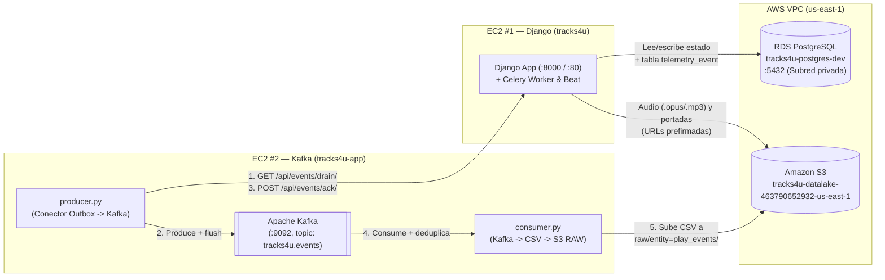

# Tracks4U — Data Engineering Platform (Django + RDS PostgreSQL + S3 + Kafka Streaming)

**Integrantes:**
- **Miguel Angel García Osorio** (App Django `tracks4u`, Esquema, Outbox de Telemetría, S3 Media)
- **Dorian Alejandro Guisao Ospina**
- **Sergio** (Esquema SQL y Carga de Datos `database/schema.sql`, `database/seed.sql`)
- **Juanc** (Ingesta Batch/CDC con AWS Glue + Step Functions + EventBridge, `etl_watermark`)
- **Lalo** (Ingesta Streaming con Apache Kafka → S3 RAW en `tracks4u-streaming/`)

---

## 1. Arquitectura de Despliegue entre las dos EC2, RDS y S3



---

## 2. Paso a Paso en la EC2 #1 (Donde corre Django `tracks4u`)

### 2.1 Preparar el entorno e instalar dependencias
Conéctate por SSH a la **EC2 de Django** (que debe estar en la misma VPC para alcanzar al RDS privado):

```bash
git clone <URL_DEL_REPO> tracks4uProject
cd tracks4uProject
git checkout feat/data-platform

python3 -m venv .venv
source .venv/bin/activate
pip install -r tracks4u/requirements.txt
```

### 2.2 Configurar `tracks4u/.env`
Copia el archivo de ejemplo y completa la contraseña de RDS y el token de drenaje:

```bash
cp tracks4u/.env.example tracks4u/.env
nano tracks4u/.env
```

Valores clave en `tracks4u/.env`:
```env
SECRET_KEY=<cadena_aleatoria_50_caracteres>
DEBUG=true
ALLOWED_HOSTS=localhost,127.0.0.1,0.0.0.0,<IP_PRIVADA_EC2_DJANGO>,<IP_PUBLICA_EC2_DJANGO>
CSRF_TRUSTED_ORIGINS=http://localhost,http://<IP_PUBLICA_EC2_DJANGO>:8000

DB_HOST=tracks4u-postgres-dev.c4qkjciamuny.us-east-1.rds.amazonaws.com
DB_PORT=5432
DB_NAME=tracks4u
DB_USER=tracks4u_app
DB_PASSWORD=<PASSWORD_DE_TRACKS4U_APP>
DB_SSLMODE=require

AWS_STORAGE_BUCKET_NAME=tracks4u-datalake-463790652932-us-east-1
AWS_S3_REGION_NAME=us-east-1

TELEMETRY_DRAIN_TOKEN=<TOKEN_COMPARTIDO_CON_EC2_DE_KAFKA_MIN_32_CHARS>
TELEMETRY_SETTLE_SECONDS=5
TELEMETRY_RETENTION_DAYS=7
TELEMETRY_DRAIN_MAX_LIMIT=1000
NOTIFICATION_MODE=MOCK
```

### 2.3 Aplicar migraciones en RDS, sembrar datos y subir las 36 canciones a S3
Desde `tracks4u/`:

```bash
cd ~/tracks4uProject/tracks4u
source ../.venv/bin/activate

# 1. Verifica conexión a RDS y aplica database/schema.sql + tablas internas de Django
python manage.py check --database default
python manage.py migrate

# 2. (Si aún no se ha cargado database/seed.sql en RDS)
PGSSLMODE=require psql -h tracks4u-postgres-dev.c4qkjciamuny.us-east-1.rds.amazonaws.com \
  -U tracks4u_app -d tracks4u -f ../database/seed.sql

# 3. Sube las 36 canciones (.opus) y 33 portadas de cancionesCovers/tracks4u/ a S3
#    y actualiza títulos limpios, duration_sec, precios, géneros y keys S3 en RDS:
python manage.py sync_seed_media
```

### 2.4 Levantar Django en la EC2 #1
Para que la otra EC2 (la de Kafka) pueda conectarse, levanta Django escuchando en `0.0.0.0:8000` (o con `docker compose up -d` en el puerto `80`):

```bash
cd ~/tracks4uProject/tracks4u
source ../.venv/bin/activate
python manage.py runserver 0.0.0.0:8000
```

---

## 3. Cómo Conectar la EC2 de Django con la otra EC2 donde está Kafka (`tracks4u-app`)

Tienes **dos formas** de conectar ambas instancias EC2 dentro de la VPC. Elige la que prefieras según dónde quieras correr `producer.py`:

### Opción A (Recomendada — Sin tocar Kafka): `producer.py` corre en la EC2 de Kafka (`tracks4u-app`) y drena a la EC2 de Django por HTTP

En esta opción, Kafka se queda escuchando en `127.0.0.1:9092` dentro de `tracks4u-app` tal como ya está levantado, y `producer.py` (corriendo en `tracks4u-app`) consulta por HTTP a la EC2 de Django.

1. **Security Group de la EC2 de Django:**
   - Abre el puerto **`8000`** (o `80` si usas Nginx) permitiendo tráfico TCP entrante desde el Security Group o la **IP privada de la EC2 de Kafka (`tracks4u-app`)**.
2. **En la EC2 de Kafka (`tracks4u-app`, carpeta `~/tracks4u-streaming`):**
   Actualiza `producer.py`, `consumer.py` y `requirements.txt` con los de `tracks4u-streaming/tracks4u-streaming/` e instala `requests`:
   ```bash
   cd ~/tracks4u-streaming
   source venv/bin/activate
   pip install -r requirements.txt
   ```
3. **Terminal 1 en `tracks4u-app` — Arrancar `consumer.py` (Kafka → S3 RAW):**
   ```bash
   cd ~/tracks4u-streaming
   source venv/bin/activate
   export AWS_DEFAULT_REGION=us-east-1
   export S3_BUCKET=tracks4u-datalake-463790652932-us-east-1
   export BOOTSTRAP=127.0.0.1:9092
   python consumer.py
   ```
4. **Terminal 2 en `tracks4u-app` — Arrancar `producer.py` apuntando a la IP privada de la EC2 de Django:**
   ```bash
   cd ~/tracks4u-streaming
   source venv/bin/activate
   export DJANGO_URL=http://<IP_PRIVADA_EC2_DJANGO>:8000
   export TELEMETRY_DRAIN_TOKEN=<MISMO_TOKEN_DEL_ENV_DE_DJANGO>
   export BOOTSTRAP=127.0.0.1:9092
   python producer.py
   ```

---

### Opción B: `producer.py` corre en la EC2 de Django y publica por red a la EC2 de Kafka (`tracks4u-app:9092`)

Si prefieres ejecutar `producer.py` dentro de la **EC2 de Django** y que envíe los eventos por red al broker Kafka en la otra EC2 (`tracks4u-app`):

1. **Security Group de la EC2 de Kafka (`tracks4u-app`):**
   - Abre el puerto **`9092` (TCP)** permitiendo tráfico entrante desde el Security Group o la **IP privada de la EC2 de Django**.
2. **En la EC2 de Kafka (`tracks4u-app`) — Exponer `KAFKA_HOST` con su IP privada:**
   Por defecto el `docker-compose.yml` de Kafka anuncia `127.0.0.1:9092`. Para que acepte conexiones desde la otra EC2, reinícialo pasando la IP privada de `tracks4u-app`:
   ```bash
   cd ~/tracks4u-streaming
   KAFKA_HOST=<IP_PRIVADA_EC2_KAFKA> docker compose up -d
   ```
   Y en esa misma EC2 de Kafka deja corriendo `consumer.py`:
   ```bash
   cd ~/tracks4u-streaming
   source venv/bin/activate
   AWS_DEFAULT_REGION=us-east-1 \
   S3_BUCKET=tracks4u-datalake-463790652932-us-east-1 \
   BOOTSTRAP=<IP_PRIVADA_EC2_KAFKA>:9092 \
   python consumer.py
   ```
3. **En la EC2 de Django — Arrancar `producer.py` apuntando al Kafka remoto:**
   ```bash
   cd ~/tracks4uProject/tracks4u-streaming/tracks4u-streaming
   source ../../.venv/bin/activate
   pip install -r requirements.txt

   DJANGO_URL=http://127.0.0.1:8000 \
   TELEMETRY_DRAIN_TOKEN=<MISMO_TOKEN_DEL_ENV_DE_DJANGO> \
   BOOTSTRAP=<IP_PRIVADA_EC2_KAFKA>:9092 \
   python producer.py
   ```

---

## 4. Prueba Rápida de Verificación (End-to-End)

1. Desde la **EC2 de Django**, inyecta un evento de prueba al outbox:
   ```bash
   curl -i -X POST http://127.0.0.1:8000/api/events/ \
     -H "Content-Type: application/json" \
     -d '{
       "event_id": "7b0c4c2e-5a4e-4c5e-9c77-0b6a2a7a3f10",
       "event_type": "play_start",
       "session_id": "s_ec2_test",
       "device": "web_desktop",
       "entrypoint": "home",
       "payload": {"track_id": 6}
     }'
   ```
2. Pasados 5 segundos (ventana de asentamiento `TELEMETRY_SETTLE_SECONDS=5`), verás en la consola de `producer.py`:
   ```text
   Drenados y confirmados 1 eventos (acked=1, cursor=0 -> 1)
   ```
3. Y en la consola de `consumer.py` (en `tracks4u-app`) al cumplirse los 10 segundos o 100 eventos:
   ```text
   Guardados 1 eventos en datalake/raw/entity=play_events/ingest_date=.../events_....csv -> s3://tracks4u-datalake-463790652932-us-east-1/raw/entity=play_events/ingest_date=.../events_....csv
   ```
4. Verifica el archivo en S3:
   ```bash
   aws s3 ls s3://tracks4u-datalake-463790652932-us-east-1/raw/entity=play_events/ --recursive
   ```
